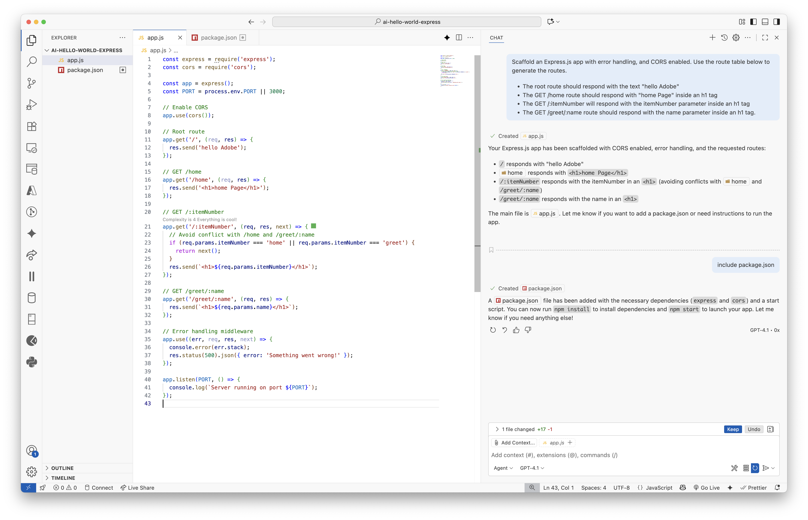
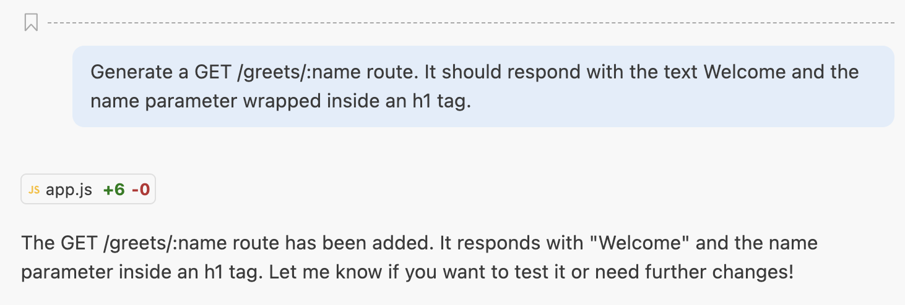
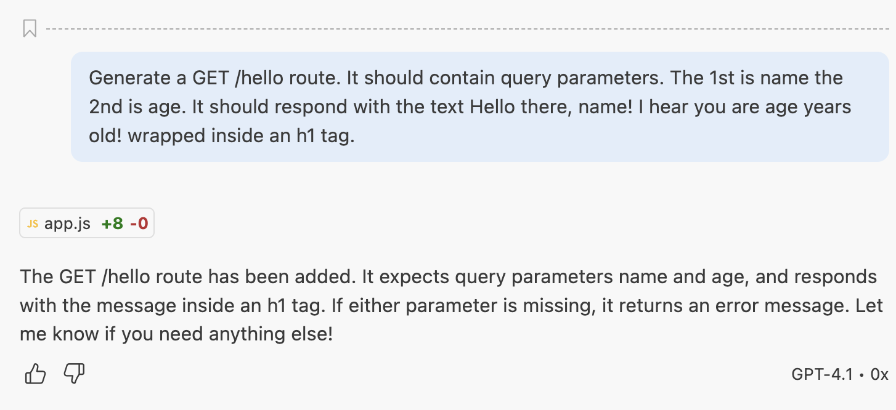
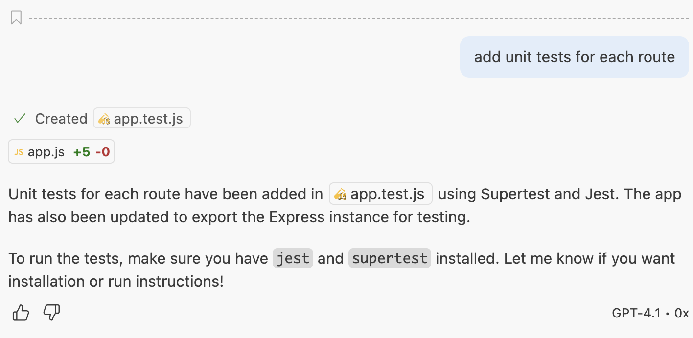
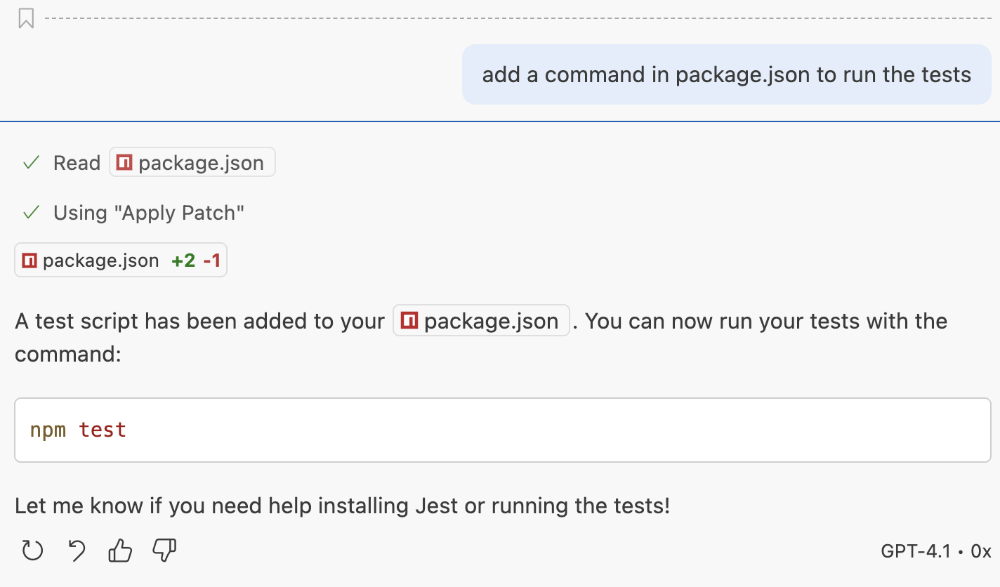
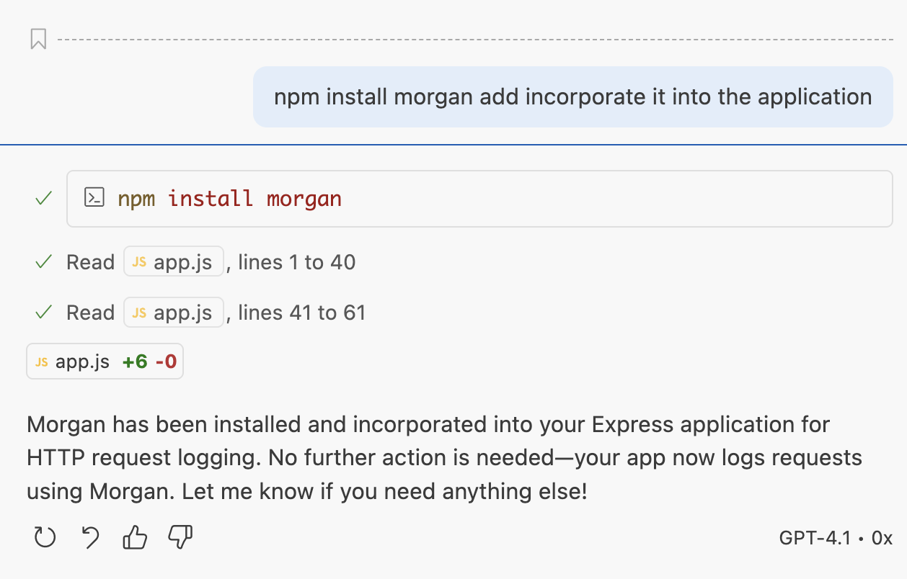
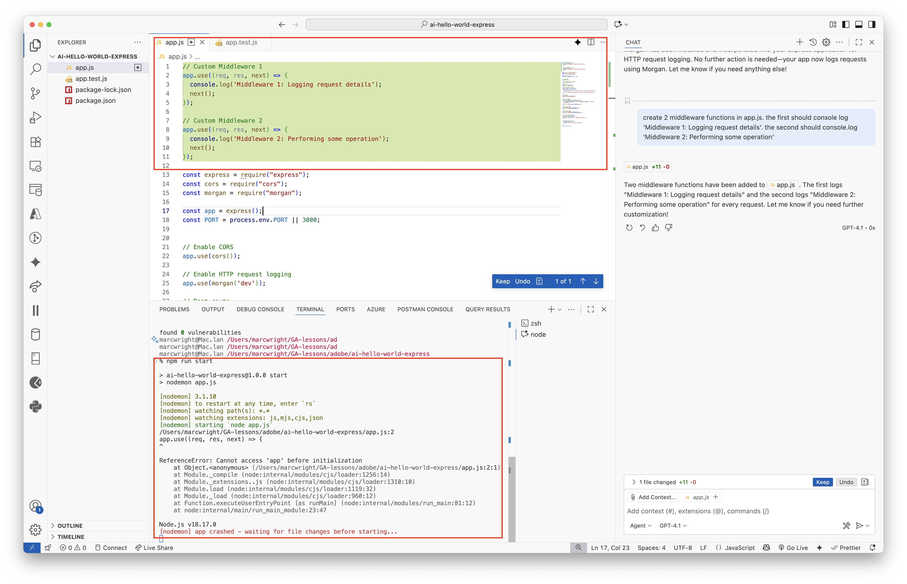

<h1>
  <span class="headline">Ai Express Scaffolding</span>
  <span class="subhead">Lesson</span>
</h1>

## Vibe Coding

Confirm that the code is in the correct place/order in the file.

## What are Context and Agents?

## Setup

tktk The below is a generic starting point for lecture setup. You may need to make adjustments to this.

Open your Terminal application and navigate to your <code class="filepath">~/code/ga/lectures</code> directory:

```bash
cd ~/code/ga/lectures
```

Make a new directory called <code class="filepath">ai-hello-world-express-app</code>, then enter this directory:

```bash
mkdir ai-hello-world-express-app
cd ai-hello-world-express-app
```

Open the contents of the directory in VS Code:

```bash
code .
```

Run `npm install` and `npm start`


## Scaffold

```bash
Scaffold an Express.js app with error handling, nodemon, and CORS enabled. Use the route table below to generate the routes.

The root route should respond with the text "hello Adobe"
The GET /home route should respond with "home Page" inside an h1 tag
The GET /:itemNumber will respond with the itemNumber parameter inside an h1 tag
The GET /greet/:name route should respond with the name parameter inside an h1 tag.
```

  


## URL params in Express Route

```bash
Generate a GET /greet/:name route. It should respond with the text Welcome and the name parameter wrapped inside an h1 tag.
```

  

## Query params in Express Route

```bash
Generate a GET /hello route. It should contain query parameters. The 1st is name the 2nd is age. It should respond with the text Hello there, name! I hear you are age years old! wrapped inside an h1 tag.
```
  
  

## Generate Tests

```bash
add unit tests for each route
```

  

```bash
install jest and supertest
```

  

```bash
add a command in package.json to run the tests
```

  

## Install Morgan

```bash
npm install morgan add incorporate it into the application
```

  


```bash
create 2 middleware functions in app.js. the first should console log 'Middleware 1: Logging request details'. the second should console.log 'Middleware 2: Performing some operation'
```

  

Note - the code looks correct, but it's in the wrong place and our server crashes. Trust but verify. It needs to be after our `app.use()` methods.

  


## tktk Next Section Title

tktk Write the content for the lesson here.

`app.js`

```js
const express = require("express");
const cors = require("cors");
const morgan = require("morgan");

const app = express();
const PORT = process.env.PORT || 3000;


// Enable CORS
app.use(cors());

// Enable HTTP request logging
app.use(morgan('dev'));


// Custom Middleware 1
app.use((req, res, next) => {
  console.log('Middleware 1: Logging request details');
  next();
});

// Custom Middleware 2
app.use((req, res, next) => {
  console.log('Middleware 2: Performing some operation');
  next();
});


// Root route
app.get("/", (req, res) => {
  res.send("hello Adobe");
});
// GET /hello?name=...&age=...
app.get("/hello", (req, res) => {
  const { name, age } = req.query;
  if (!name || !age) {
    return res.status(400).send("<h1>Missing name or age query parameter</h1>");
  }
  res.send(`<h1>Hello there, ${name}! I hear you are ${age} years old!</h1>`);
});

// GET /home
app.get("/home", (req, res) => {
  res.send("<h1>home Page</h1>");
});

// GET /:itemNumber
app.get("/:itemNumber", (req, res, next) => {
  // Avoid conflict with /home and /greet/:name
  if (req.params.itemNumber === "home" || req.params.itemNumber === "greet") {
    return next();
  }
  res.send(`<h1>${req.params.itemNumber}</h1>`);
});

// GET /greet/:name
app.get("/greet/:name", (req, res) => {
  res.send(`<h1>${req.params.name}</h1>`);
});

// GET /greets/:name
app.get("/greets/:name", (req, res) => {
  res.send(`<h1>Welcome ${req.params.name}</h1>`);
});

// Error handling middleware
app.use((err, req, res, next) => {
  console.error(err.stack);
  res.status(500).json({ error: "Something went wrong!" });
});


if (require.main === module) {
  app.listen(PORT, () => {
    console.log(`Server running on port ${PORT}`);
  });
}

module.exports = app;
```

`app.test.js`

```js
const request = require('supertest');
const express = require('express');
let app;

describe('Express App Routes', () => {
  beforeAll(() => {
    app = require('./app');
  });

  test('GET / should return hello Adobe', async () => {
    const res = await request(app).get('/');
    expect(res.statusCode).toBe(200);
    expect(res.text).toBe('hello Adobe');
  });

  test('GET /home should return home Page in h1', async () => {
    const res = await request(app).get('/home');
    expect(res.statusCode).toBe(200);
    expect(res.text).toBe('<h1>home Page</h1>');
  });

  test('GET /123 should return 123 in h1', async () => {
    const res = await request(app).get('/123');
    expect(res.statusCode).toBe(200);
    expect(res.text).toBe('<h1>123</h1>');
  });

  test('GET /greet/John should return John in h1', async () => {
    const res = await request(app).get('/greet/John');
    expect(res.statusCode).toBe(200);
    expect(res.text).toBe('<h1>John</h1>');
  });

  test('GET /greets/Jane should return Welcome Jane in h1', async () => {
    const res = await request(app).get('/greets/Jane');
    expect(res.statusCode).toBe(200);
    expect(res.text).toBe('<h1>Welcome Jane</h1>');
  });

  test('GET /hello?name=Sam&age=25 should return greeting in h1', async () => {
    const res = await request(app).get('/hello?name=Sam&age=25');
    expect(res.statusCode).toBe(200);
    expect(res.text).toBe('<h1>Hello there, Sam! I hear you are 25 years old!</h1>');
  });

  test('GET /hello missing params should return error', async () => {
    const res = await request(app).get('/hello');
    expect(res.statusCode).toBe(400);
    expect(res.text).toMatch(/Missing name or age/);
  });
});
```

`package.json`

```js
{
  "name": "ai-hello-world-express",
  "version": "1.0.0",
  "description": "Express.js app with CORS and error handling for Adobe lesson.",
  "main": "app.js",
  "scripts": {
    "start": "nodemon app.js",
    "test": "jest"
  },
  "keywords": [
    "express",
    "cors",
    "adobe",
    "lesson"
  ],
  "author": "",
  "license": "ISC",
  "dependencies": {
    "cors": "^2.8.5",
    "express": "^4.18.2",
    "morgan": "^1.10.1",
    "nodemon": "^3.1.10"
  },
  "devDependencies": {
    "jest": "^30.1.3",
    "supertest": "^7.1.4"
  }
}
```

