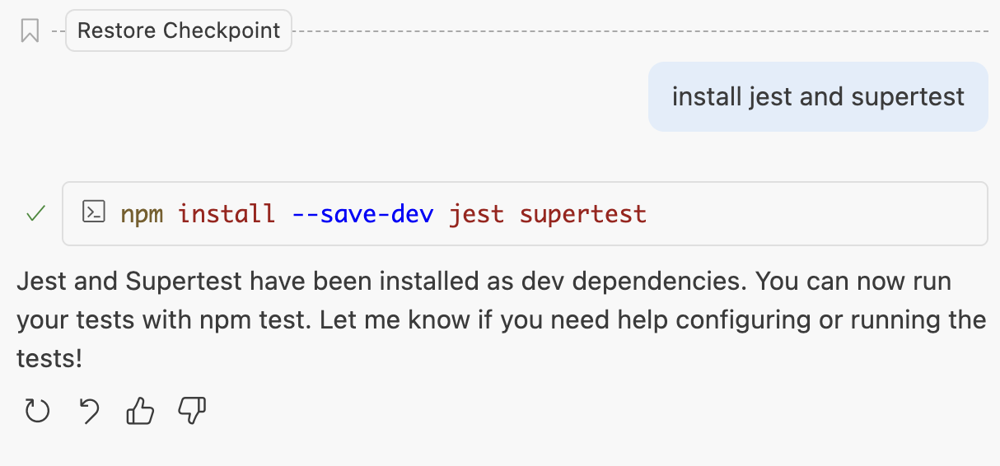
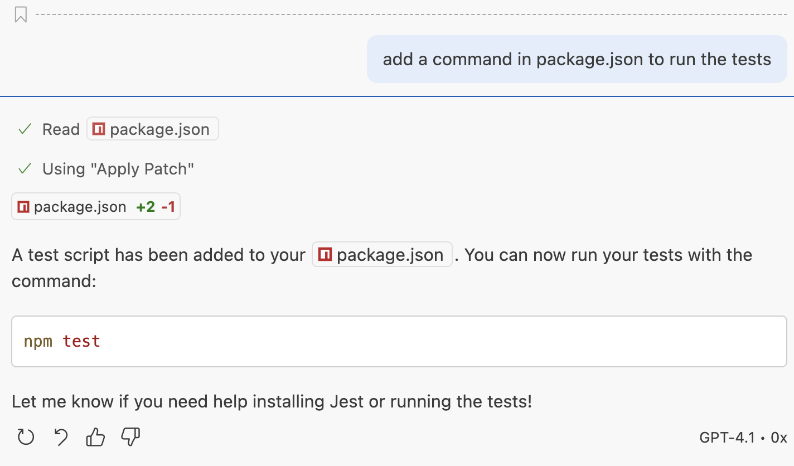

<h1>
  Generate Unit Tests for an Express Application with GitHub Copilot Concepts
</h1>

## Generate Tests

__Below is a sample prompt for an Express application. NOTE - Your GitHub Copilot generated code may vary slightly from the screenshots below. Trust but verify!__

Let Github Copilot guide you through this section.

__SAMPLE PROMPT:__ "add unit tests for each route"

  

__SAMPLE PROMPT:__ "install jest and supertest"

  

__SAMPLE PROMPT:__ "add a command in package.json to run the tests"

  

__See if all the tests pass.__

  

