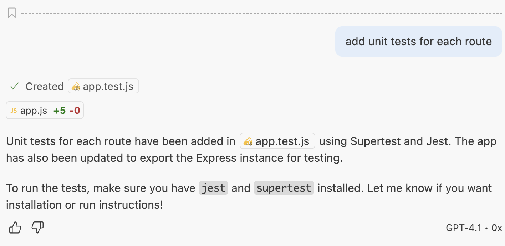
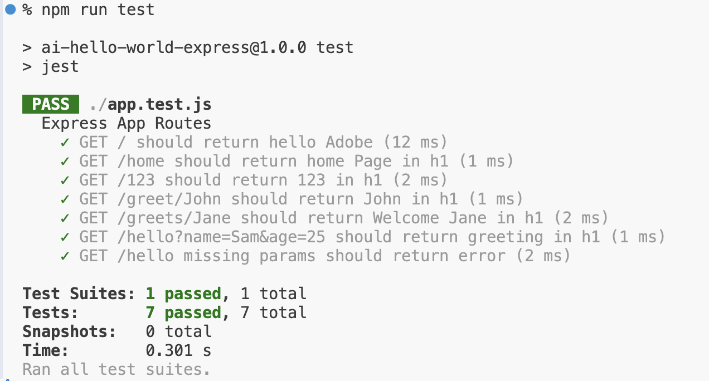

<h1>
  <span class="headline">Generate Unit Tests for an Express Application with GitHub Copilot Concepts</span>
</h1>

**Learning Objective:**  By the end of this lesson, students will be able to use URL parameters in Express routes to handle dynamic data in requests.

## Generate Tests

```bash
add unit tests for each route
```

  

```bash
install jest and supertest
```

  

```bash
add a command in package.json to run the tests
```

  




