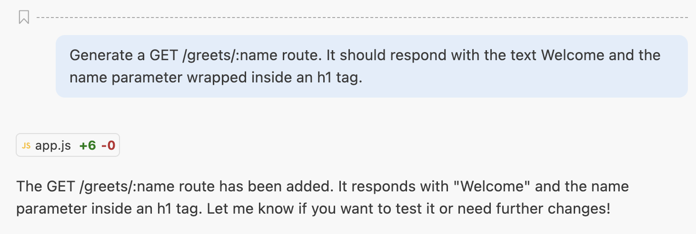
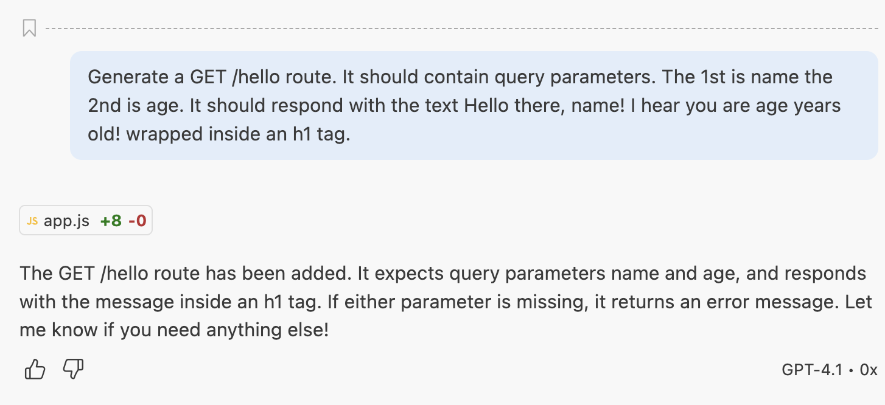

<h1>
  Generate URL params routes
</h1>

**Learning Objective:**  By the end of this lesson, students will be able to use URL parameters in Express routes to handle dynamic data in requests.

## URL params in Express Route

PROMPT: __Generate a GET /greet/:name route. It should respond with the text Welcome and the name parameter wrapped inside an h1 tag.__

  

  ## Query params in Express Route
  
PROMPT: __Generate a GET /hello route. It should contain query parameters. The 1st is name the 2nd is age. It should respond with the text Hello there, name! I hear you are age years old! wrapped inside an h1 tag.__
    
  
  

