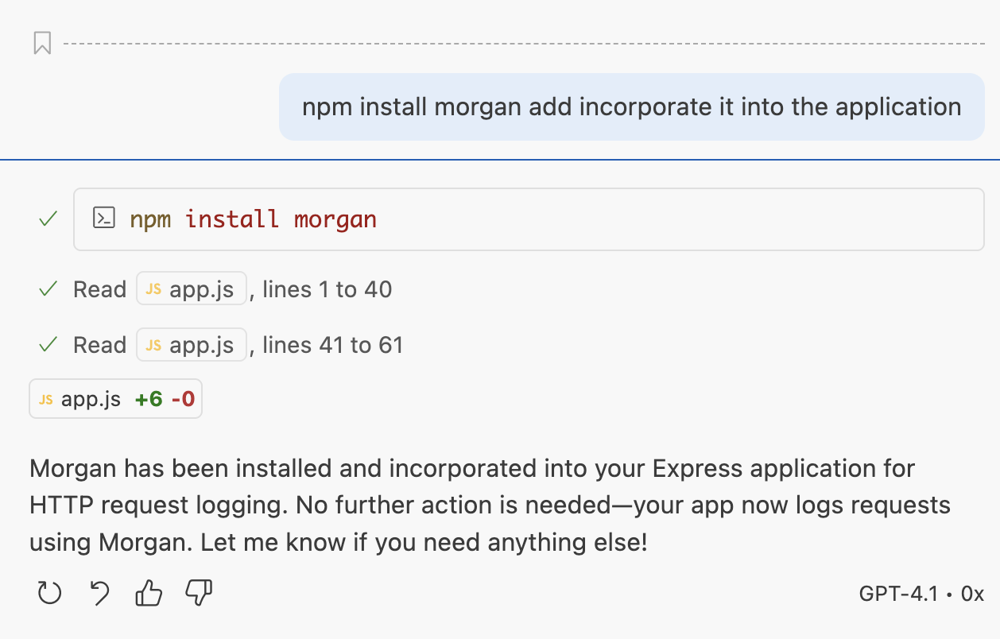
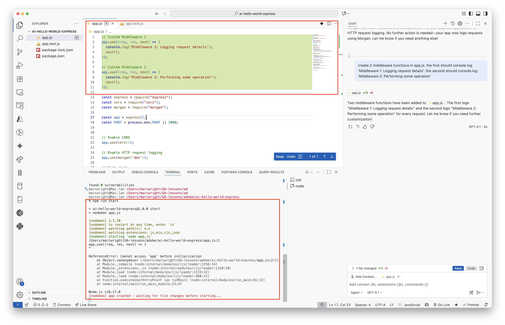
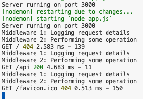

<h1>
  Add Morgan to the Express Application
</h1>

## Install Morgan

[Morgan](https://github.com/expressjs/morgan) is an HTTP request logger middleware for Node.js, primarily used with the Express.js framework. It simplifies the process of logging details about incoming HTTP requests to your application. 

__Below are sample prompts for an Express application. NOTE - Your GitHub Copilot generated code may vary slightly. Trust but verify!__

__SAMPLE PROMPT:__ "npm install morgan and incorporate it into the application"

  

__SAMPLE PROMPT:__ "create 2 middleware functions in app.js. the first should console log 'Middleware 1: Logging request details'. the second should console.log 'Middleware 2: Performing some operation"

  

Note - the code looks correct, but it's in the wrong place and our server crashes. __Trust but verify.__ It needs to be after our `app.use()` methods.

  

Once your code is wired up correctly you should see the logs in your server output.

  