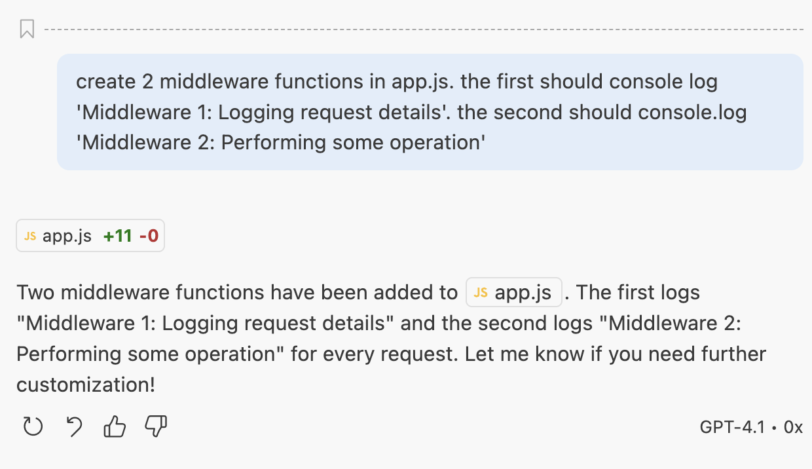

<h1>
  Generate Unit Tests for an Express Application with GitHub Copilot Concepts
</h1>

**Learning Objective:**  By the end of this lesson, students will be able to use URL parameters in Express routes to handle dynamic data in requests.

## Install Morgan

PROMPT: __npm install morgan and incorporate it into the application__

  

PROMPT: __create 2 middleware functions in app.js. the first should console log 'Middleware 1: Logging request details'. the second should console.log 'Middleware 2: Performing some operation__

  

Note - the code looks correct, but it's in the wrong place and our server crashes. Trust but verify. It needs to be after our `app.use()` methods.

  