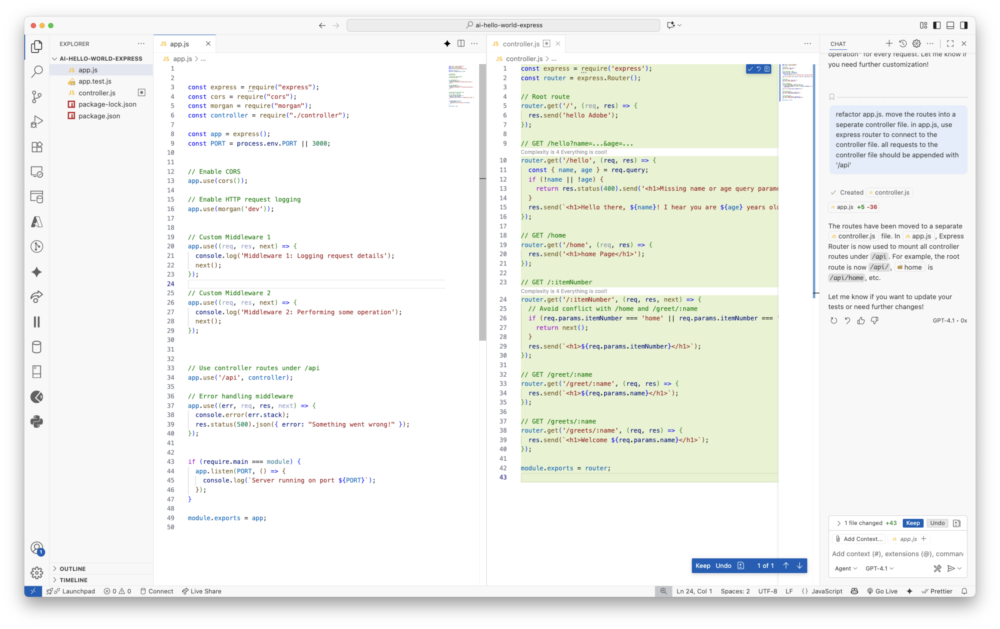

<h1>
  <span class="headline">Refactor routes with GitHub Copilot Concepts</span>
</h1>

**Learning Objective:** By the end of this lesson, students will understand the basics of the Express framework, its applications, and the core functionalities of web application frameworks.

## Scaffold

```bash
refactor app.js. move the routes into a seperate controller file. in app.js, use express router to connect to the controller file. all requests to the controller file should be appended with '/api'
```

