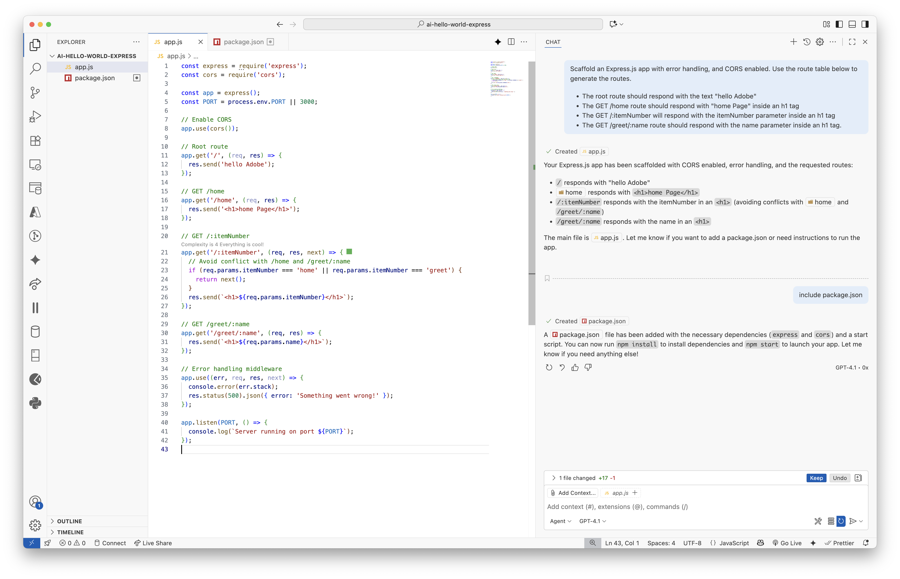

<h1>
  <span class="headline">Scaffold an Express Application with GitHub Copilot Concepts</span>
</h1>

**Learning Objective:** By the end of this lesson, students will understand the basics of the Express framework, its applications, and the core functionalities of web application frameworks.

## Scaffold

```bash
Scaffold an Express.js app with error handling, nodemon, and CORS enabled. Use the route table below to generate the routes.

The root route should respond with the text "hello Adobe"
The GET /home route should respond with "home Page" inside an h1 tag
The GET /:itemNumber will respond with the itemNumber parameter inside an h1 tag
The GET /greet/:name route should respond with the name parameter inside an h1 tag.
```

  

Run `npm install` and `npm start`