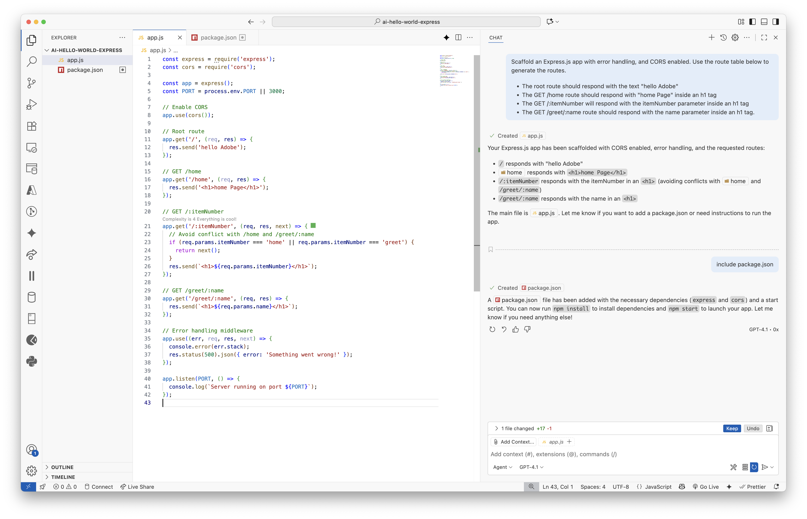
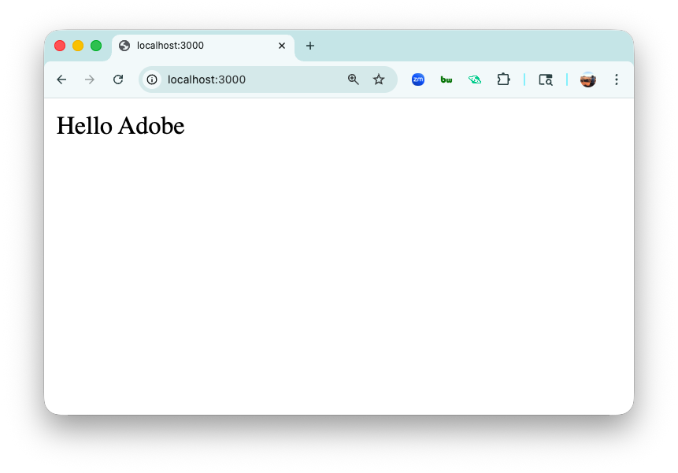
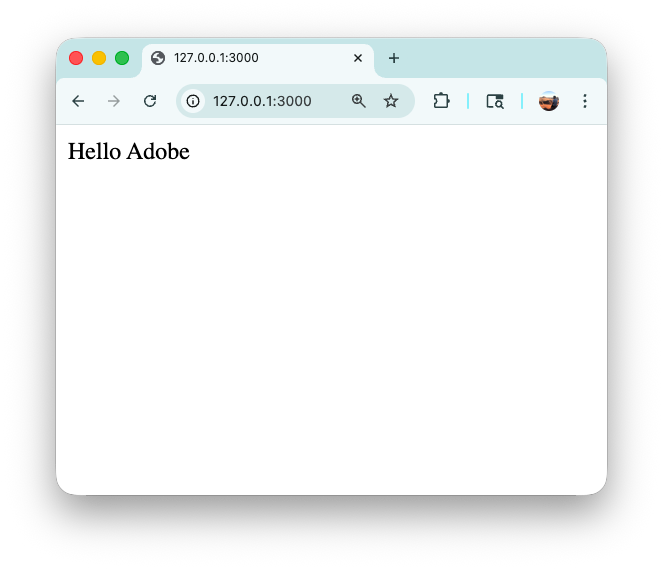
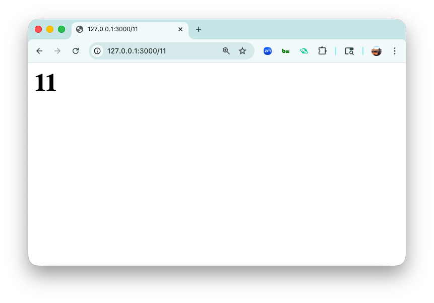
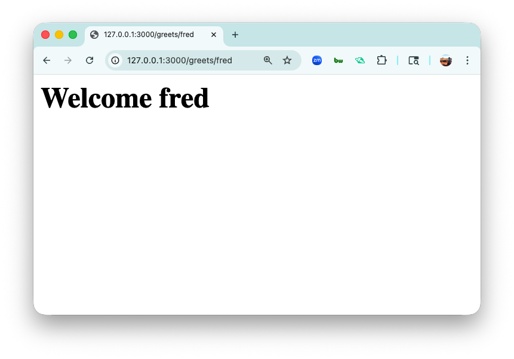

<h1>
  <span class="headline">Scaffold an Express Application with GitHub Copilot Concepts</span>
</h1>

## Scaffold With GiHub Copilot

Below is a sample prompt for an Express application. NOTE - Your GitHub Copilot generated code may vary slightly from the screenshot below. Trust but verify!

__SAMPLE PROMPT:__ 

```plaintext
Scaffold an Express.js app with error handling, nodemon, and CORS enabled. Use the route table below to generate the routes.

* The root route should respond with the text "Hello Adobe".
* The GET /home route should respond with "Home Page" inside an h1 tag.
* The GET /:itemNumber will respond with the itemNumber parameter inside an h1 tag.
* The GET /greet/:name route should respond with the name parameter inside an h1 tag.
```

__Here is what was generated.__

  

__Run `npm install` and `npm start` and make sure you do not have errors. Copilot may even offer to run these commands for you.__


## Test the GitHub Copilot generated endpoints

**NOTE - Your GitHub Copilot generated code may vary slightly from the screenshot below. Trust but verify!**

1. `The root route should respond with the text "Hello Adobe".`

    ```js
    // Root route
    app.get('/', (req, res) => {
      res.send('Hello Adobe');
    });
    ```
  
    Navigate to http://localhost:3000/

  

2. `The GET /home route should respond with "Home Page" inside an h1 tag.`

    ```js
    // GET /home
    app.get('/home', (req, res) => {
      res.send('<h1>Home Page</h1>');
    });
    ```

    Navigate to http://localhost:3000/home

  

3. `The GET /:itemNumber will respond with the itemNumber parameter inside an h1 tag.`

    ```js
    app.get('/:itemNumber', (req, res, next) => {
      // Avoid conflict with /home and /greet/:name
      if (req.params.itemNumber === 'home' || req.params.itemNumber === 'greet') {
        return next();
      }
      res.send(`<h1>${req.params.itemNumber}</h1>`);
    });
    ```

    Navigate to http://localhost:3000/11

  

4. `The GET /greet/:name route should respond with the name parameter inside an h1 tag.`

    ```js
    // GET /greets/:name
    app.get('/greets/:name', (req, res) => {
      res.send(`<h1>Welcome ${req.params.name}</h1>`);
    });
    ```

    Navigate to http://localhost:3000/greets/fred

  

<br>

## Bonus - And Additional User Story

Use Copilot to generate some code based on this user story:

```plaintext
As a visitor to the API,
I want to send a GET request to /api/hello with my name and age as query parameters,
So that I receive a personalized greeting message displaying my name and age inside an <h1> tag.
If I forget to provide either my name or age,
I want to see an error message indicating that a required query parameter is missing.
```

<details>
<summary>Here's what was generated for me</summary>

  ```js
  // GET /hello?name=...&age=...
  app.get('/hello', (req, res) => {
    const { name, age } = req.query;
    if (!name || !age) {
      return res.status(400).send('<h1>Missing name or age query parameter</h1>');
    }
    res.send(`<h1>Hello there, ${name}! I hear you are ${age} years old!</h1>`);
  });
  ```

</details>

<br>

## Bonus #2

Notice that the `/greets/:name` will always return a lowercase version of the name. Using AI, refactor the route so that the name will be returned with a capitalized first letter.